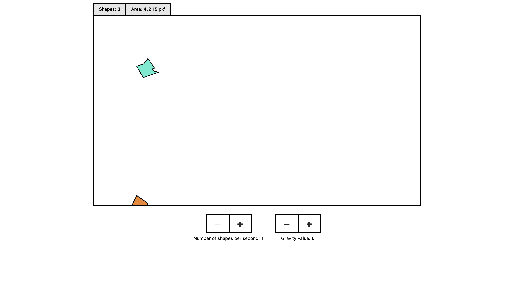

# Falling Shapes (TypeScript)

## Run
    npm install
    npm run dev      # http://localhost:5173

## Structure
    src/
      main.ts                 wiring: DOM, settings, controls, app
      styles.css
      core/    App.ts         PIXI app, mask, main loop (composition root)
               Config.ts      all tunable constants
      shapes/  Shape.ts       one falling, poolable shape
               ShapeFactory   Factory: random irregular polygon + colour + area
               ShapePool      Object pool (no GC churn)
               ShapeManager   spawn / simulate / remove / stats
               Spawner        frame-rate independent 1/rate emitter
      state/   Observable.ts  Observer pattern
               Settings.ts    rate + gravity
      ui/      Hud.ts         HTML text fields (shape count, area)
               StepperControl +/- HTML controls
      utils/   random.ts, geometry.ts

## Demo

